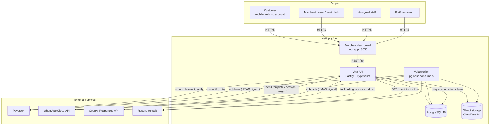
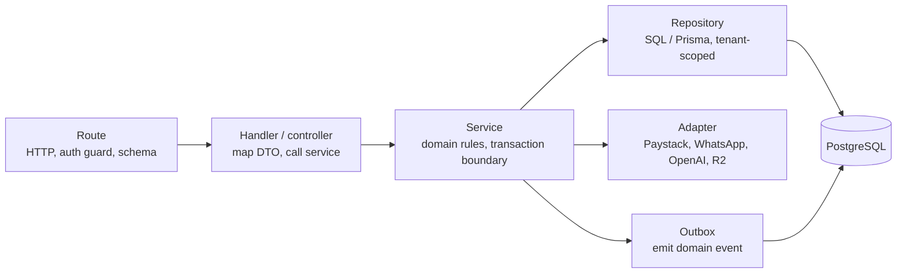
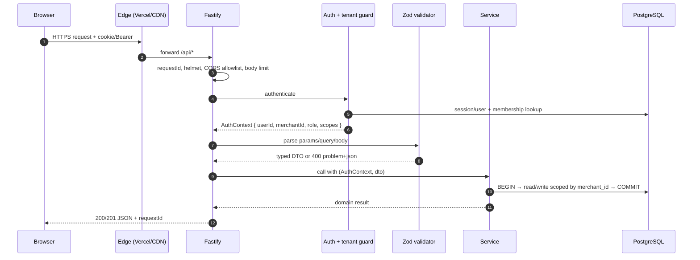
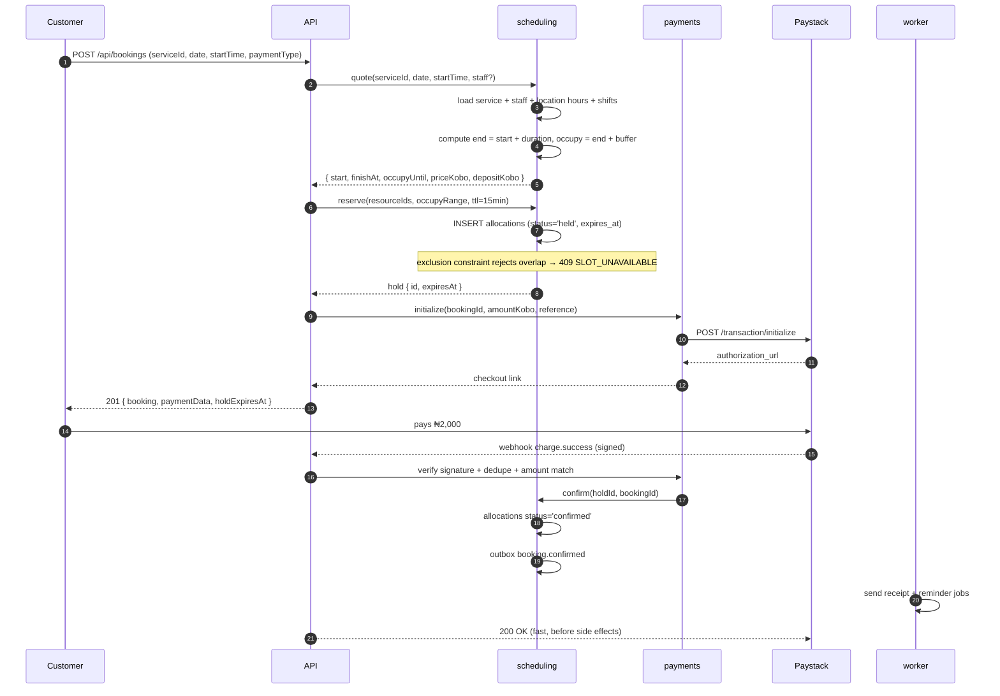
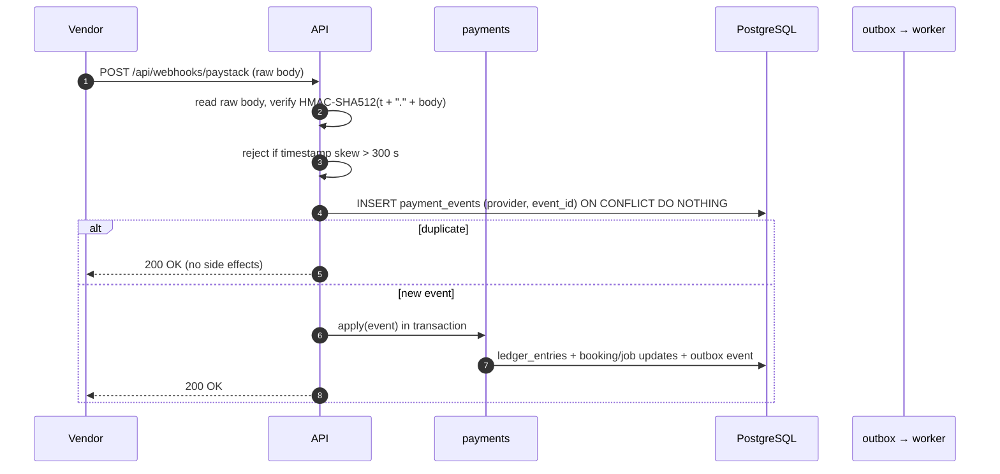
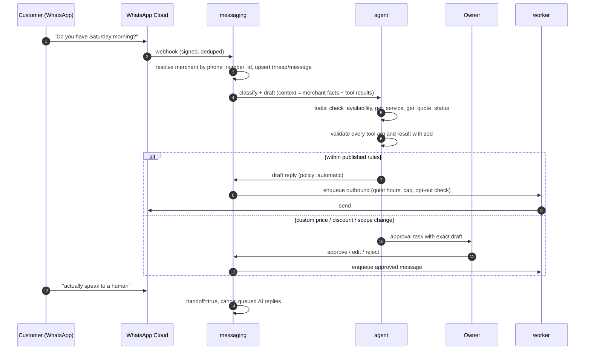
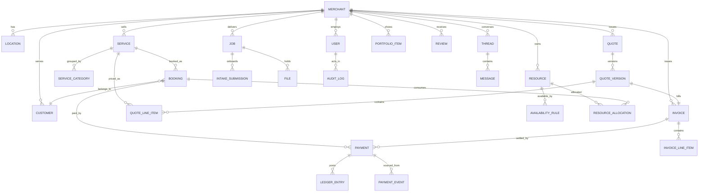
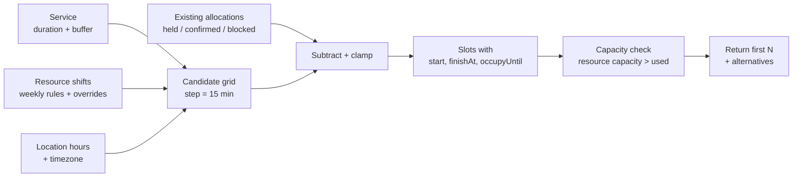

# Vela Backend — Component Architecture

**Status:** design for approval · **Build window:** 1 week · **Owner:** backend
**Companions:** [SECURITY.md](./SECURITY.md) (enforced controls) · [PLAN.md](./PLAN.md) (day-by-day execution)

This document is the map we build against. It answers three questions before a line of code is written:

1. **What are the components?** — a modular monolith with one HTTP process and one worker process.
2. **How do they talk?** — synchronous calls inside the process, explicit interfaces between modules, transactional outbox for anything that must not be lost.
3. **Where is the truth?** — PostgreSQL. Nothing important lives in memory, in the browser, or in a vendor's response.

---

## 1. Scope this week

| In scope (must ship) | Out of scope (explicitly deferred) |
| --- | --- |
| Auth (register, OTP, login, refresh, logout), staff accounts, RBAC | SSO / social login |
| Merchant + location + settings | Custom domain purchase (keep contract stub) |
| Services, categories, portfolio, reviews | Advanced website builder / themes |
| Availability engine, holds, bookings, buffers, walk-ins | Multi-location transfer tooling |
| Paystack checkout, verified webhooks, ledger, refunds | Flutterwave, Stripe, bank-transfer auto-recon |
| Quotes with immutable versions, invoices, deposits | E-signatures / PDF contract generation |
| Jobs, intake forms, client portal links, delivery states | Delivery partner integrations |
| File uploads with signed URLs | Video transcoding, image AI tagging |
| Admin read/ops surfaces + audit log | Full analytics warehouse |
| WhatsApp + AI agent behind a feature flag, approval-gated | Unattended autonomous outbound at scale |

The PRD's release acceptance tests 1–6, 8–12 are the definition of a working system (see PLAN.md §3 for the exact mapping).

---

## 2. Principles (each one changes the code)

| # | Principle | Concrete consequence |
| --- | --- | --- |
| P1 | **One deployable, clear seams** | `apps/api` and `apps/worker` share `src/modules/*`. No network hop between our own modules. |
| P2 | **Modules own their tables** | `schedule` does not read `payment` tables. Cross-module needs go through a service interface or an event. |
| P3 | **Tenant is never client-supplied** | `merchant_id` comes from the verified token + membership lookup, never from body, query, or path. |
| P4 | **The server owns time and money** | Duration, buffer, end time, totals, deposit, and fees are recomputed server-side. Client values are hints only. |
| P5 | **Concurrency is a database problem** | Double-booking is prevented by a PostgreSQL exclusion constraint, not by a JavaScript `if`. |
| P6 | **Every state change is attributable** | `updated_at`, `updated_by`, and an `audit_logs` row for money, role, and booking changes. |
| P7 | **Async work is durable** | Domain events are written in the same transaction as the state change (outbox) and delivered by pg-boss. |
| P8 | **Idempotent at every boundary** | Payment webhooks, booking creation, and message sends are safe to replay. |
| P9 | **Fail closed** | Missing config, unknown role, unverified webhook, expired hold → reject, never "allow and log". |
| P10 | **Boring, typed, tested** | Strict TypeScript, schema validation at the edge, unit tests for pricing/time, integration tests for auth and money. |

---

## 3. System context



**Trust boundaries:** the browser is untrusted; vendor webhooks are untrusted until signature + replay checks pass; the AI model is untrusted output. Only the API and worker hold credentials.

---

## 4. Containers and why they exist

| Container | Responsibility | Scaling unit | Notes |
| --- | --- | --- | --- |
| **Web app** (root `server.js` + `dashboard.html`) | Rendering, form state, optimistic UI | Static CDN | The shipped dashboard at `/dashboard`. We satisfy its contract; see [DASHBOARD_CONTRACT.md](./DASHBOARD_CONTRACT.md). |
| **API** (`apps/api`) | AuthN/Z, validation, domain rules, sync vendor calls, webhook intake | Stateless, N replicas | No cron, no long tasks. P95 target < 300 ms excluding vendor calls. |
| **Worker** (`apps/worker`) | Reminders, hold expiry, webhook follow-ups, campaign sends, reconciliation, AI jobs | 1–2 replicas, concurrency per queue | Same image, different entrypoint. Restart-safe by design. |
| **PostgreSQL** | System of record + job queue (pg-boss) + outbox | Managed (Neon/Render) | `btree_gist` extension required. |
| **R2 bucket** | Private merchant files, portfolio images | Object storage | No public objects; signed URLs only. |
| **Vendor APIs** | Payments, messaging, AI, email | External | All calls wrapped in adapters with timeouts, retries, and circuit-breaking. |

**Why not microservices:** one week, one team, one database. Module boundaries give us the option to split later without paying the distributed-systems tax now.

---

## 5. Inside the API

### 5.1 Layering rule



Hard rules:

- Routes never touch the database. Services never read `request`/`reply`.
- Repositories never make policy decisions (no `if role === ...`).
- Adapters never see domain objects; they take explicit primitives and return typed results.
- A service method = one transaction unless it explicitly documents otherwise.

### 5.2 Module map

```text
api/
├── apps/
│   ├── api/                 # Fastify bootstrap, plugins, route registration
│   └── worker/              # pg-boss bootstrap, queue handlers
├── src/
│   ├── modules/
│   │   ├── identity/        # users, sessions, OTP, staff, RBAC
│   │   ├── tenancy/         # merchants, locations, settings, domains
│   │   ├── catalog/         # services, categories, portfolio, reviews
│   │   ├── scheduling/      # availability, holds, bookings, resources
│   │   ├── sales/           # opportunities, quotes, invoices
│   │   ├── payments/        # intents, webhooks, ledger, refunds
│   │   ├── jobs/            # job briefs, intake forms, delivery states
│   │   ├── messaging/       # threads, WhatsApp, templates, opt-outs
│   │   ├── agent/           # AI orchestration, tools, guardrails
│   │   ├── files/           # upload intents, signed URLs, quotas
│   │   ├── admin/           # platform ops, diagnostics, moderation
│   │   └── analytics/       # read models for Today/dashboard
│   ├── platform/            # db, config, logger, errors, outbox, idempotency
│   ├── shared/              # money, time, result types, pagination
│   └── contracts/           # zod schemas + generated OpenAPI
├── prisma/                  # schema + raw SQL migrations
├── test/                    # unit, integration, concurrency
└── docker-compose.yml       # local Postgres
```

Each module exposes exactly one `index.ts` (its public interface) and keeps everything else internal. ESLint enforces no deep imports across modules (`import/no-restricted-paths` or `eslint-plugin-boundaries`).

### 5.3 What talks to what

| From → To | Mode | Contract | Why |
| --- | --- | --- | --- |
| Web → API | sync HTTPS | REST/JSON, `Authorization` or session cookie | Only public interface |
| API → Postgres | sync | Prisma + raw SQL for constraints | System of record |
| API → Paystack | sync | create/verify transaction; 10 s timeout | Customer waits for checkout link |
| API → WhatsApp | sync | template/session send; 10 s timeout | Inbox responsiveness |
| API → OpenAI | sync | Responses API with tools; 20 s timeout | Agent reply drafting |
| API → R2 | sync | presign PUT/GET | Uploads never proxy through API |
| Paystack → API | sync inbound | webhook, raw body, HMAC | Money truth |
| WhatsApp → API | sync inbound | webhook, raw body, HMAC | Conversation truth |
| API → Postgres outbox | sync (same tx) | `outbox_events` row | Nothing lost on crash |
| outbox → pg-boss | async | dispatcher polls every 1 s | Durable delivery |
| worker → Postgres / vendors | async | queue handler | Reminders, retries, reconciliation |
| agent → scheduling/sales | sync in-process | tool interface, tenant-scoped | One code path for availability and pricing |

**No module talks to a vendor directly except through its adapter.** Swapping Paystack for another gateway later touches one folder.

---

## 6. Request lifecycle



Every response carries `x-request-id`. Every error is machine-readable:

```json
{
  "message": "This time is no longer available.",
  "code": "SLOT_UNAVAILABLE",
  "requestId": "01J...",
  "details": { "alternatives": ["2026-11-28T14:00:00Z"] }
}
```

`message` is kept because the dashboard displays it. `code` is what our tests and UI logic use.

---

## 7. The flows that matter

### 7.1 Booking with hold and deposit (Journey A)



Rules the code enforces:

- `endTime` from the client is **ignored**; it is derived from `service.duration_minutes`.
- The block is `[start, start + duration + buffer)`. Customer sees `finishAt`; the calendar frees at `occupyUntil`.
- Hold TTL is 15 minutes (configurable per merchant, max 30). A worker sweeps expired holds every minute.
- Zero-deposit merchants skip Paystack and confirm in the same transaction.
- If payment settles after hold expiry: record the money, re-check availability, and if gone, open an `EXCEPTION_PAID_UNSCHEDULED` task. Never silently double-book.
- Concurrency: two requests for the same slot → PostgreSQL rejects the second `INSERT`; API returns `409` with alternatives. This is acceptance test #2.

### 7.2 Quote → acceptance → deposit → job (Journey B)

```mermaid
sequenceDiagram
    autonumber
    participant O as Owner
    participant API as API
    participant SAL as sales
    participant PAY as payments
    participant JOB as jobs

    O->>API: POST /api/quotes (opportunityId, lineItems[])
    SAL->>SAL: snapshot prices into quote_version v1 (draft)
    O->>API: POST /api/quotes/:id/send
    SAL->>SAL: v1 status='sent', valid_until set, share token hashed
    Note over SAL: Editing creates v2 and marks v1 'superseded'
    C->>API: GET /api/public/quotes/:token
    C->>API: POST /api/public/quotes/:token/accept (v2 only)
    SAL->>SAL: accept v2 atomically; reject if not latest or expired
    SAL->>SAL: create invoice (40% deposit, balance later)
    API->>PAY: initialize deposit
    PAY-->>API: checkout link
    PS-->>API: webhook → verify → ledger entry
    API->>JOB: create job (status 'awaiting_intake') + portal token
    JOB->>JOB: prefill date/venue from quote; checklist tasks
    Note over JOB: Undated project → no resource allocation, no invented appointment
```

Invariants: quote versions are immutable once sent; acceptance binds the **latest** version only; invoice totals equal the accepted version total; job creation is triggered by the payment event, not the browser redirect.

### 7.3 Webhook intake (all vendors, one pattern)



Vendor calls must return fast (under 5 s). Anything slow becomes a queue job. If processing throws, we return `5xx` so the vendor retries, and the event row is marked `failed` with attempt count.

### 7.4 Inbound message → agent → human approval



The model never receives database credentials, never sets a price, and never picks a booking ID it invented. Tools are functions in `agent/tools/*` that call the same services the API uses, with `merchantId` injected server-side.

---

## 8. Data model

### 8.1 Aggregate map



### 8.2 Non-negotiable constraints

| Constraint | Definition | Protects |
| --- | --- | --- |
| No double allocation | `EXCLUDE USING gist (resource_id WITH =, tstzrange(starts_at, ends_at, '[)') WITH &&) WHERE (status IN ('held','confirmed','blocked'))` | Acceptance #2, #5 |
| One active hold per booking | partial unique index on `resource_allocations(booking_id)` where `status='held'` | Retry safety |
| Money is integer | `amount_kobo BIGINT`, `CHECK (amount_kobo >= 0)` | Rounding bugs |
| Ledger is append-only | no `UPDATE`/`DELETE` grants on `ledger_entries` | Reconciliation |
| Invoice totals reconcile | `total_kobo = SUM(line_items)`, `balance_kobo = total - paid` | Money truth |
| One accepted version | partial unique index on `quote_versions(quote_id)` where `status='accepted'` | Acceptance #3 |
| Webhook dedupe | `UNIQUE (provider, provider_event_id)` | Acceptance #5 |
| Tenant key everywhere | `merchant_id NOT NULL` on all tenant tables, composite indexes lead with it | Isolation |
| Soft delete | `deleted_at` on customer-facing content, hard delete only for PII erasure jobs | Auditability |

`btree_gist` must be created in the first migration. Prisma cannot express exclusion constraints, so it lives in a hand-written SQL migration and is covered by a concurrency test.

### 8.3 Time and money rules

- Timestamps: `timestamptz`, stored UTC. Merchant timezone is an IANA string (`Africa/Lagos`), applied only at the edges (display, availability generation, quiet hours).
- Durations: integer minutes.
- Money: integer kobo. `₦10,000` is `1_000_000`. Formatting happens in the client.
- Currency is `NGN` this week; the column exists so it is not a migration later.

---

## 9. Availability engine

The PRD formula, implemented as one pure function plus one query:

```text
available = (qualified shifts ∩ location hours ∩ resource capacity)
            − (confirmed allocations + active holds + buffers)
            − (blackout dates + lead-time cutoff)
```



Implementation notes:

- Generate candidates in the merchant timezone, convert to UTC before comparing.
- Buffer is occupancy-only: it consumes the resource but is not shown to the customer.
- Staff selection: named staff → that resource; "first available" → order by least-utilised, then earliest.
- Walk-ins use the same `reserve()` path with `source='walk_in'`; no bypass.
- The engine is pure and unit-tested against the PRD example: 45-min service + 10-min buffer at 13:00 → customer finishes 13:45, resource free 13:55.

---

## 10. API contract

### 10.1 Conventions

| Topic | Decision |
| --- | --- |
| Base path | `/api` (same origin as the dashboard in development; `https://api.<domain>/api` in production) |
| Versioning | `/api` is v1. Breaking changes go to `/api/v2`; additive fields are always allowed. |
| Auth | httpOnly `__Host-vela_session` cookie **and** `Authorization: Bearer` for tooling and tests. |
| Content type | `application/json`; webhooks use `application/json` with raw-body capture. |
| Validation | Zod schemas in `src/contracts`, shared with OpenAPI generation. Unknown keys rejected. |
| Pagination | `?page=1&limit=20` (max 100), response `{ data, pagination: { page, limit, total, totalPages } }`. |
| Errors | `{ message, code, requestId, details? }`, RFC 7807-shaped. `message` is what the dashboard displays. |
| Idempotency | `Idempotency-Key` header required on `POST /bookings`, `/quotes/:id/send`, `/payments/*`. 24 h retention. |
| Rate limits | Per IP + per user, see SECURITY.md §9. |
| OpenAPI | Generated from Zod, published at `/api/docs` (non-production) and committed as `openapi.json`. |

### 10.2 Endpoint inventory (mapped to the shipped dashboard)

> The authoritative endpoint list is [DASHBOARD_CONTRACT.md](./DASHBOARD_CONTRACT.md) §5.
> This table tracks module coverage; route names follow the dashboard wherever it already calls them.

| Module | Endpoints | Week-1 status |
| --- | --- | --- |
| identity | `POST /auth/register`, `/verify-otp`, `/resend-otp`, `/login`, `/logout`, `/refresh`, `/forgot-password`, `/reset-password`, `GET /auth/me`, `PATCH /auth/profile` | Build; dashboard auth screens are demo-only today |
| staff | `GET/POST /staff`, `DELETE /staff/:id` | Build |
| catalog | `/services` CRUD, `/services/provider/:slug`, `/service-categories` CRUD + reorder | Build |
| catalog | `/auth/portfolio`, `/auth/portfolio/:index`, `/reviews/*` | Build |
| scheduling | `GET/PUT /schedule`, `/schedule/provider/:slug`, `GET /availability` (new), `/bookings` CRUD-ish, `/bookings/stats` | Build |
| sales | `/quotes`, `/quotes/:id/send`, `/quotes/:id/versions`, `/public/quotes/:token/accept` | Build (new surface) |
| payments | `/payments/paystack/verify`, `/payments/banks`, `/payments/verify-bank`, `/payments/transactions`, `/transactions/:id/verify`, `/refund`, `/webhooks/paystack` | Build |
| jobs | `/jobs`, `/jobs/:id`, `/public/jobs/:token`, `/intake/:token` | Build (new surface) |
| dashboard | `GET /dashboard/summary`, `/dashboard/today`, `/money/summary`, `/money/ledger`, `/clients` | Build |
| inbox | `GET /conversations`, `/conversations/:id`, `PATCH /conversations/:id/mode`, `POST /conversations/:id/draft`, `/approve`, `/dismiss` | Build (agent behind a flag) |
| integrations | `/apps` catalogue, `/apps/payment-gateways`, `/apps/:id/credentials`, `/apps/:id/keys`, `/apps/:id/connect`, `/apps/:id/disconnect`, `/apps/:id/rotate-key`, `/apps/:id/currency-default`, `/apps/webhook-waiting`, `/webhooks/test-trigger`, `/retry` | Build; route names match the dashboard's current calls |
| admin | `/admin/stats`, `/providers`, `/bookings`, `/customers`, `/transactions`, `/payouts`, `/refunds`, `/settings`, `/risk`, `/verifications` | Build read paths; writes behind role check |
| domains | `/domains/check`, `/domains/purchase` | Stub with `501` + contract |

Compatibility note: the existing client sends `paymentType: 'deposit' | 'full' | 'pay_later' | 'bank_transfer'` and a client-computed `timeSlot`. We accept the shape but derive money and timing server-side; `pay_later` and `bank_transfer` are feature-flagged per merchant.

---

## 11. Async work

| Queue | Producer | Job | Retry policy |
| --- | --- | --- | --- |
| `holds.expire` | scheduler (every 60 s) | release stale holds, notify waiting list | 3×, then alert |
| `booking.reminders` | `booking.confirmed` | 24 h + 2 h reminders (WhatsApp/email) | 5× backoff, skip if booking cancelled |
| `payments.reconcile` | `payment.pending` | poll Paystack verify for 15 min | 5×, then exception task |
| `messaging.outbound` | agent / campaign approval | send template, respect quiet hours + caps | 3×, dead-letter on permanent failure |
| `campaigns.send` | owner approval | batch send with per-recipient eligibility check | per-recipient, capped |
| `notifications.email` | OTP, receipts, invites | Resend send | 3× |
| `files.cleanup` | daily | delete orphaned uploads, enforce quota | idempotent |
| `agent.draft` | inbound message | classify, draft, tool calls | 2×, then human queue |

Rules: handlers are idempotent (keyed by aggregate ID + job type), every job logs `merchantId` and correlation ID, and no handler holds a DB transaction while calling a vendor.

---

## 12. State machines

**Booking:** `pending_payment → confirmed → checked_in → completed`; `pending_payment → expired`; any → `cancelled` (policy-checked); `confirmed → no_show`.

**Allocation:** `held → confirmed | expired | released`; `confirmed → released` (only via cancellation policy); `blocked` is created manually and has no booking.

**Quote version:** `draft → sent → accepted | declined | expired | superseded`.

**Invoice:** `draft → open → partially_paid → paid | void`; `open → overdue` (derived, not stored twice).

**Payment:** `initialized → pending → succeeded | failed | abandoned`; `succeeded → partially_refunded → refunded`.

**Job:** `awaiting_intake → ready → in_progress → delivered → closed`; `cancelled` from any pre-delivery state.

**Opportunity:** `new → qualifying → quote_sent | booking_offered → awaiting_deposit → won | lost`.

Transitions are validated in the service layer against an explicit allow-list; illegal transitions return `409 INVALID_TRANSITION`, never a silent update.

---

## 13. Cross-cutting

| Concern | Decision |
| --- | --- |
| Config | `zod`-validated env at boot; process exits on missing/invalid. No defaults for secrets. |
| Logging | Pino JSON: `requestId`, `merchantId`, `userId`, `route`, `latency`. Redact `authorization`, `cookie`, `password`, `otp`, `card*`, `secret`. |
| Errors | Typed `AppError` subclasses → one error handler → problem JSON. Unknown errors become `500` with no internals leaked. |
| DB access | Prisma for CRUD, raw SQL for constraints/aggregates. One `withTenant()` helper that injects `merchant_id` and asserts it on every query. |
| Migrations | Expand → deploy → contract. Forward-only, reviewed, run in CI against a scratch database. |
| Testing | Unit: availability, money, state machines. Integration: auth, tenant isolation, webhooks, booking race. Contract: response shapes vs [DASHBOARD_CONTRACT.md](./DASHBOARD_CONTRACT.md) §4–5. |
| CI | typecheck → lint → unit → integration (Postgres service) → build → migration check → dependency audit. |
| Deploy | API and worker from the same image; staging auto, production manual approval. Health: `/health/live`, `/health/ready`. |
| Backups | Managed daily + PITR; restore drill documented, not assumed. |

---

## 14. Decisions (ADR index)

| ID | Decision | Alternative rejected | Reason |
| --- | --- | --- | --- |
| D1 | Modular monolith, two entrypoints | Microservices | One week; seams preserved for later split |
| D2 | Fastify 5 + strict TS + Zod | Express, Nest | Speed, schema-first, low ceremony |
| D3 | PostgreSQL + Prisma + raw SQL migrations | Mongo, Drizzle-only | Transactions, exclusion constraints, relational reporting |
| D4 | Allocation table with exclusion constraint | App-level locking | Correct under concurrency, survives multiple API replicas |
| D5 | Integer kobo everywhere | Floats/decimals in app code | Paystack parity, no rounding drift |
| D6 | Transactional outbox + pg-boss | Direct enqueue in handler | No lost events on crash |
| D7 | Vendor adapters behind interfaces | Inline SDK calls | Testability, swap path |
| D8 | httpOnly session cookie, Bearer fallback | Bearer only | XSS risk in current client; migration path in PLAN.md |
| D9 | Immutable quote versions | Mutating a quote | Legal/audit clarity, acceptance test #3 |
| D10 | Signed URLs for all file reads | Public bucket / API proxy | Acceptance #12, bandwidth |
| D11 | AI tools call internal services | Model-generated SQL/API calls | Prompt injection containment |
| D12 | Feature flags for agent + outbound | Ship both on | Protects pilot merchants and costs |

---

## 15. Assumptions and open questions

1. **Ownership (decided 27 Nov 2026):** the root app's dashboard at `localhost:3030/dashboard` is the frontend of record. `client/` stays until the gaps in [DASHBOARD_CONTRACT.md](./DASHBOARD_CONTRACT.md) §7 are closed.
2. **Hosting:** API on Render/Fly, Postgres managed, R2 for files. Confirm procurement this week or use local Docker for the demo.
3. **Paystack:** test keys + a test subaccount available by day 3; webhook tunnel (ngrok/cloudflared) for local verification.
4. **WhatsApp:** a test number and approved template by day 5, otherwise the adapter ships with a sandbox flag and the channel stays off.
5. **AI:** OpenAI key and a monthly cap per merchant; agent stays behind a flag until evaluation passes.
6. **Email:** Resend domain verification; until then OTP logs to the console in development only.

---

## 16. Approved stack and dependencies

Stack approved on 26 Nov 2026. Versions are pinned in `package.json` + lockfile; upgrades are a separate PR.

| Layer | Choice | Version discipline |
| --- | --- | --- |
| Runtime | Node.js 22 LTS (`.nvmrc`, `engines`) | Local 24 is fine; CI and deploy use 22 |
| Language | TypeScript | 5.x, `strict`, `noUncheckedIndexedAccess`, `exactOptionalPropertyTypes` |
| HTTP | Fastify | 5.x |
| Validation | Zod | 3.x |
| ORM | Prisma | 6.x + raw SQL migrations for constraints |
| DB | PostgreSQL | 16+, `btree_gist`, `pgcrypto` |
| Jobs | pg-boss | 10.x (uses the same Postgres) |
| Auth | `@fastify/jwt` + `argon2` | argon2id parameters in SECURITY.md §2 |
| Time | `date-fns` + `date-fns-tz` | No `moment` |
| Storage | `@aws-sdk/client-s3` + `s3-request-presigner` | R2 is S3-compatible |
| AI | `openai` | Responses API, server-side only |
| Email | `resend` | Falls back to console in dev |
| Logging | `pino` (+ `pino-pretty` in dev) | Redaction config lives in `platform/logger.ts` |
| Rate limiting | `@fastify/rate-limit` + `ioredis` store | In-memory only in local dev |
| Testing | `vitest` + `fastify.inject()` | No supertest, no live port needed |
| Tooling | `tsx`, `eslint` 9 flat config, `prettier`, `gitleaks` in CI | — |

**Deliberate deviation:** no Paystack SDK. The adapter uses `fetch` plus `node:crypto`, because webhook verification needs the exact raw bytes and the SDK would add a dependency we cannot audit in a week.

Install:

```bash
npm i fastify @fastify/cors @fastify/helmet @fastify/rate-limit @fastify/cookie \
  @fastify/jwt @fastify/multipart @prisma/client pg-boss argon2 zod \
  date-fns date-fns-tz @aws-sdk/client-s3 @aws-sdk/s3-request-presigner \
  openai resend pino ioredis

npm i -D typescript tsx prisma vitest @vitest/coverage-v8 eslint prettier \
  pino-pretty @types/node
```

**Dependency policy**

- Every new runtime dependency needs one sentence in the PR: what it replaces and why we cannot write it in <50 lines.
- No package with an unmaintained lockfile, no `postinstall` from an unverified publisher, no duplicate of a library we already have.
- `npm audit --omit=dev` blocks high/critical in CI. Lockfile is committed and reviewed when it changes.
- `uuid` is not needed: PostgreSQL `gen_random_uuid()` / UUIDv7 for internal IDs, `crypto.randomBytes(32)` for public tokens.

---

## 17. What "done" looks like

- `docker compose up` → Postgres with extensions, migrations applied, API and worker healthy.
- `GET /health/ready` returns `200` with DB and queue checks.
- The two PRD journeys run end-to-end against the shipped dashboard on `:3030`.
- Acceptance tests 2, 3, 5, 6, 12 pass as automated integration tests.
- `openapi.json` matches the implemented routes; CI is green; no secret in git; `npm audit` has no high/critical.
- Every money, role, and booking mutation is in `audit_logs`.
